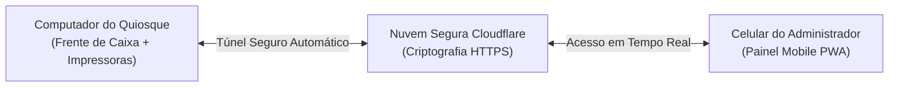

# Guia de Acesso Remoto e Versão Mobile ADM — Rota do Forte

Este guia explica como o Administrador pode acompanhar o estoque, alertas de reposição e faturamento do quiosque pelo celular, de qualquer lugar do mundo, mantendo o computador do quiosque como central de vendas e impressões.

---

## 1. Como Funciona a Arquitetura



- **No Quiosque (Computador Principal)**:
  - Roda o PDV para os atendentes venderem e emitirem cupons e comandas nas impressoras térmicas.
  - O banco de dados local grava todas as movimentações.
- **No Celular do Dono/ADM**:
  - Acessa o link seguro do Cloudflare.
  - Abre a versão exclusiva **Mobile ADM (`/mobile.html`)**.
  - Visualiza estoque em tempo real, produtos que estão acabando e quanto o quiosque já faturou hoje.
  - Se o dono comprar mercadoria na rua, ele pode alterar o estoque direto pelo celular!

---

## 2. Passo a Passo para Ativar o Acesso via Cloudflare (Custo Zero)

### Passo 1: Instalar o Cloudflared (apenas na 1ª vez no PC do quiosque)
Abra o **PowerShell** ou Prompt de Comando do Windows e execute o comando oficial da Microsoft:
```bash
winget install Cloudflare.cloudflared
```
*(Ou baixe o instalador `.msi` direto do site da Cloudflare).*

### Passo 2: Iniciar o Túnel
Na pasta do sistema (`d:\Rota do forte`), dê dois cliques no arquivo:
👉 **`iniciar_tunnel_cloudflare.bat`**

O Cloudflare iniciará a conexão e exibirá na tela um link seguro exclusivo, parecido com:
```text
https://sua-loja-praia.trycloudflare.com
```

---

## 3. Como Abrir e Instalar no Celular como Aplicativo (PWA)

1. Pegue o link gerado pelo Cloudflare e adicione `/mobile.html` no final:
   `https://sua-loja-praia.trycloudflare.com/mobile.html`
2. Envie o link para o seu WhatsApp e abra no celular.
3. Digite sua senha de Administrador (padrão inicial: `admin` ou a que você cadastrou).

### No iPhone (iOS):
1. Abra no navegador Safari.
2. Toque no botão de **Compartilhar** (ícone do quadrado com a seta para cima no rodapé).
3. Selecione **"Adicionar à Tela de Início"**.
4. Pronto! O ícone do **Rota do Forte** ficará na tela inicial como um app nativo, sem barras de navegador.

### No Android:
1. Abra no Google Chrome.
2. Toque no menu de três pontinhos no canto superior direito.
3. Toque em **"Instalar aplicativo"** ou **"Adicionar à tela inicial"**.
4. Pronto! O app fica instalado e integrado ao sistema.

---

## 4. O que o Administrador Consegue Fazer no Celular

| Recurso | Descrição |
| :--- | :--- |
| **Consulta de Estoque** | Busca rápida por produto, filtros por categoria e contagem de itens em estoque. |
| **Ajuste Touch no Celular** | Botões `+1`, `+10`, `-1`, `-10` para atualizar estoque enquanto confere os engradados. |
| **Central de Alertas** | Lista prioritária com os produtos que atingiram o limite mínimo (água, cerveja, etc.). |
| **Faturamento em Tempo Real** | Total vendido hoje, ticket médio e quantidade de pedidos emitidos. |
| **Formas de Pagamento** | Quanto entrou em PIX, Cartão de Débito, Crédito e Dinheiro. |
| **Status do Caixa** | Identificação de quem abriu o caixa, hora de abertura e dinheiro esperado na gaveta. |
| **Sincronização Contínua** | Atualização automática a cada 30 segundos ou com 1 toque no botão de atualizar. |
